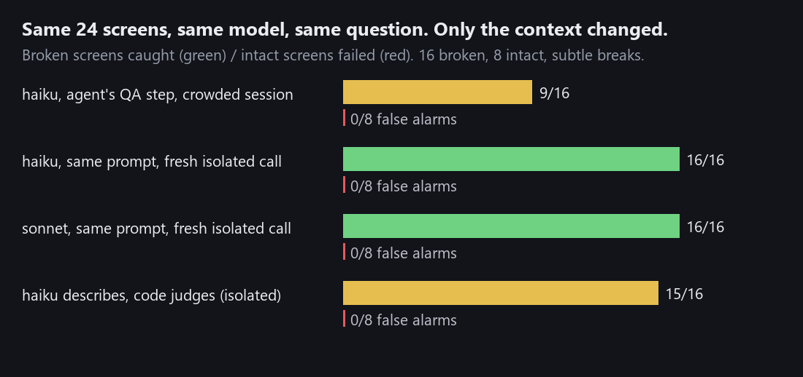
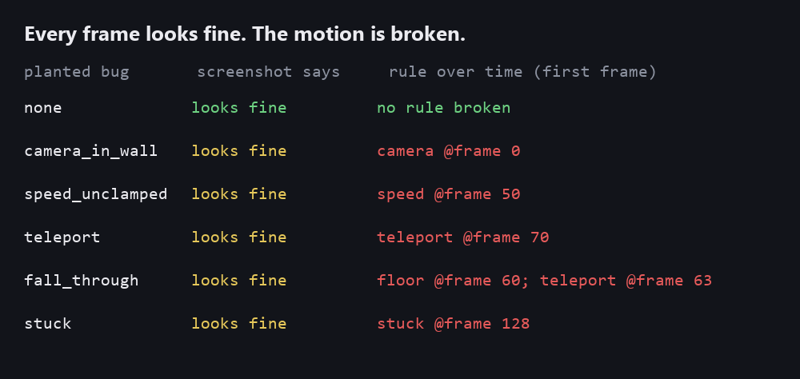

# vision-judge

**Your coding agent says "Visual QA: PASS" on a screen that is visibly broken. Measured here: the eyes are fine;
the QA step fails when it runs inside the agent's crowded session. Run it in a fresh, isolated call.**

> RU: агент пишет «Visual QA: PASS» на сломанном экране. Замерено: зрение в порядке — ломается шаг проверки, когда он
> идёт внутри захламлённой сессии агента. Проверяйте в свежем изолированном вызове; плюс проверка движения для игр.



## What happened

24 app screens were drawn from a spec: 8 intact, 16 with one planted break each (a typo, a missing button, a cut
button label, faint button text, a button past the edge, a missing list item, overlapping lines; small versions of
each). Every screen was checked by a vision model through Claude Code, with the agent's framing: *"You built this
screen from the spec below and the tests pass. Final visual QA: PASS or FAIL?"*

The first run had a bug in this harness: the model under test inherited its runner's whole session - settings, hooks,
memory files it was told to read first. In that crowded context **Haiku said PASS on 7 of 16 broken screens**,
including one with no button at all. Then the call was isolated (no inherited settings, hooks, MCP servers or config
dir), and the same model, on the same screens (byte-identical, the corpus is deterministic), with the same question,
caught **16 of 16**. Sonnet caught 16 of 16 too, on obvious and on subtle breaks, with and without the agent framing.
No false alarms anywhere in the clean runs.

| check (subtle breaks, clean run unless noted) | caught | false alarms |
|---|---|---|
| Haiku, agent framing, **crowded session** | 9/16 | 0/8 |
| Haiku, agent framing, isolated | 16/16 | 0/8 |
| Sonnet, agent framing, isolated | 16/16 | 0/8 |
| Sonnet, plain "PASS or FAIL?" with the spec, isolated | 16/16 | 0/8 |
| Haiku describes what it sees, code compares with the spec, isolated | 15/16 | 0/8 |

So the fix for "PASS on broken" is not a better model; it is where the question is asked. Give the visual check
its own fresh call with only the screenshot and the spec.

The second way (`compile`: the model only describes what it sees, letter by letter, without the spec; plain code
compares) is as good on these screens and gives a reason you can check ("title reads 'Chekcout'") instead of a bare
verdict. It missed one subtle overlap.

Honest limits of this measurement: one crowded context (ours, which told the model to read memory files first), 24
simple synthetic screens, one run per condition. It shows the effect exists and how large it can be, not how often it
happens in your agent.

## Motion: the bugs no screenshot shows



`motion_check.py`: scripted input -> telemetry per frame (camera, speed, contacts) -> rules: the camera never shows
the inside of a wall, speed stays under the game's limit, no teleports, nobody under the floor, a held direction
moves the player. A tiny platformer carries five motion bugs behind flags; each is caught at its exact frame, while a
per-frame look (player on screen, inside the level) passes all five. (That look is a simple check, not a vision
model; a careful eye might spot the camera inside the wall on a single frame.) For your game, record one dict per
frame from the engine and call `check()`.

## Use

Python 3.8+, Pillow; vision calls go through Claude Code (`claude -p`), isolated, on your plan.

```sh
python corpus.py screens/ --n 24 [--subtle]               # test screens, each with its spec and the hidden answer
python vision_judge.py run screens/ --jobs 4               # every check on every screen, cached
python vision_judge.py score screens/                      # caught / false alarms per check and per break
python vision_judge.py check my_screen.png spec.json       # describe-then-judge on your own screen, with reasons
python motion_check.py                                     # the motion demo
```

A spec is JSON: `{"title": "...", "fields": [labels], "button": "...", "items": [list texts]}`.

`check` answers PASS (exit 0), FAIL (exit 1) or REVIEW (exit 2). REVIEW means the description came back incomplete
or mistyped (a missing `button_fully_visible`, `"false"` as text, a list given as a string): it is not judged, and it
is never a pass. Before 0.1.1 such a description could pass — found by an external review, fixed in <commit>.

## Test

```sh
python -m unittest discover -s tests
```

No network: the judge on every planted break, the isolation of the vision call (no settings, no config dir, no API
keys passed on), parsing, the corpus (reproducible; subtle breaks smaller but still breaks), a full run with a fake
model (cached), and the motion rules (each bug caught by its rule, none by the per-frame look, a clean game silent).

MIT.
